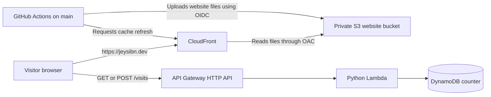

# AWS Cloud Resume Challenge

This repository contains a React portfolio and the AWS services behind its visitor counter. **Version 2 is live** at [https://jeysibn.dev](https://jeysibn.dev). CloudFront delivers the site behind this custom domain; its distribution endpoint is [d1ezqc8d2heo4m.cloudfront.net](https://d1ezqc8d2heo4m.cloudfront.net/). It runs in AWS account `665514296439`, in the Sydney region (`ap-southeast-2`), and Terraform manages its infrastructure.

Version 1 was a manually built deployment in an older AWS project. That project is closed. V1 is part of the project history; it is not running the live site.

## How the site works



CloudFront delivers the website files. It reads them from a private S3 bucket through Origin Access Control (OAC). The browser calls API Gateway directly for the counter: `GET /visits` reads the count, and clicking **Record My Visit** sends `POST /visits` to increase it. The count is recorded actions, not unique people.

Terraform creates and configures the V2 AWS resources. The DynamoDB table is managed by Terraform, while its starting counter item is initialized separately. Terraform also stores its V2 state in a dedicated S3 bucket and key.

| Part | Live V2 value |
| --- | --- |
| Main portfolio link | [jeysibn.dev](https://jeysibn.dev) |
| CloudFront distribution endpoint | [d1ezqc8d2heo4m.cloudfront.net](https://d1ezqc8d2heo4m.cloudfront.net/) |
| AWS account / region | `665514296439` / `ap-southeast-2` |
| Website bucket | `cloud-resume-v2-website-665514296439-ap-southeast-2` |
| Visitor API base URL | `https://kfpwu0cd7k.execute-api.ap-southeast-2.amazonaws.com` |
| DynamoDB table | `cloud-resume-v2-visitor-counter` |

## Tools used

- React, TypeScript, Vite, and Vitest for the website.
- Amazon S3 and CloudFront for private static hosting.
- API Gateway, Python 3.14 Lambda, and DynamoDB for the visitor counter.
- Terraform and the AWS provider pinned to `6.71.0` for infrastructure.
- GitHub Actions and OpenID Connect (OIDC) for CI and frontend delivery. OIDC gives the workflow temporary AWS credentials; the repository does not store AWS access keys.

OAC (Origin Access Control) lets CloudFront read from the private S3 bucket. Terraform state is Terraform's record of the resources it manages; this project stores it in a separate V2 S3 location.

## Run and test locally

Install frontend dependencies and create the local environment file:

```bash
cd frontend/app
npm ci
cp .env.example .env.local
```

Edit `.env.local` and set the public API URL:

```dotenv
VITE_API_BASE_URL=https://kfpwu0cd7k.execute-api.ap-southeast-2.amazonaws.com
```

This URL is public website configuration, not a secret. Never put AWS credentials in a `VITE_*` variable.

Start the local development server and open the address Vite prints (usually `http://localhost:5173`):

```bash
npm run dev
```

Run the frontend checks and build:

```bash
npm run typecheck
npm run lint
npm test -- --run
npm run build
npm run test:metadata
npm run perf:budget
```

To check dependency advisories, run `npm audit` and `npm audit --omit=dev`. The current [security note](frontend/app/DEPENDENCY-SECURITY-REVIEW.md) records moderate findings in development tools and none in production dependencies; check again because advisories change.

Optional browser checks require Playwright's browser dependencies:

```bash
npx playwright install chromium
npm run test:ui
```

Run the V2 Lambda tests from the repository root:

```bash
python3 -m unittest discover -s backend/tests -v
```

The tests mock AWS calls, so they need no AWS credentials and do not change the live counter.

## Build the Lambda package

Terraform needs a ZIP file containing the V2 Lambda handler. The ZIP is generated locally and ignored by Git. Rebuild it after changing `backend/lambda-v2/lambda_function.py`:

```bash
python3 backend/lambda-v2/package.py
```

The script creates `backend/lambda-v2/function.zip`, checks that the handler is at the archive root, and prints the ZIP checksum. Commit the handler, packager, and tests; do not commit the generated ZIP.

## Terraform: inspect before changing AWS

From the repository root, use the non-root `cloud-resume-admin` profile for account `665514296439`. Confirm the identity is not `root` before using Terraform:

```bash
export AWS_PROFILE=cloud-resume-admin
export AWS_DEFAULT_REGION=ap-southeast-2
aws sts get-caller-identity --query '{Account:Account,Arn:Arn}' --output table
```

Rebuild the Lambda ZIP, then initialize Terraform and review a plan:

```bash
python3 backend/lambda-v2/package.py
cd infra/terraform
terraform init -reconfigure
terraform fmt -check
terraform validate
terraform plan -input=false -out=.terraform/v2.tfplan
terraform show -no-color .terraform/v2.tfplan
```

Read the plan before applying it. For an intentional infrastructure change, apply only the reviewed plan with `terraform apply .terraform/v2.tfplan`. Terraform state, plans, and local working files are ignored. Keep `infra/terraform/.terraform.lock.hcl` in Git so Terraform uses the selected provider version. Never migrate or reuse state from the closed V1 project.

## Deploy the website with GitHub Actions

The workflow in `.github/workflows/deploy-v2.yml` runs frontend checks on pull requests to `main`. Pull requests do not deploy. To publish a frontend change, merge it to `main`, then manually run **V2 Portfolio CI/CD** from the GitHub Actions tab and select `main`.

The workflow builds and tests the site, passes the build to a separate deployment job, and assumes the restricted AWS role through OIDC. It uploads assets first, uploads `index.html` last, then asks CloudFront to refresh its cache. It does not delete files from the bucket. The first OIDC deployment succeeded in [GitHub Actions run 41213992608](https://github.com/Jeysibn/cloud-resume-challenge/actions/runs/41213992608).

## What this project demonstrates

The project moves from manually creating AWS resources in V1 to describing V2 infrastructure with Terraform. It also demonstrates a serverless API, persistent data, isolated Terraform state, least-privilege deployment access, OIDC, automated tests, and a reviewed frontend release process. Azure details in the portfolio describe separate historical work.

## More detail

- [Architecture](docs/architecture.md)
- [Frontend and visitor-counter integration](frontend/app/AWS-INTEGRATION.md)
- [Backend source and packaging](backend/README.md)
- [Deploy the live frontend](docs/deployment-runbook.md)
- [Validation record](docs/validation.md)
- [Project case study](docs/project-case-study.md)
- [Dependency security check](frontend/app/DEPENDENCY-SECURITY-REVIEW.md)
