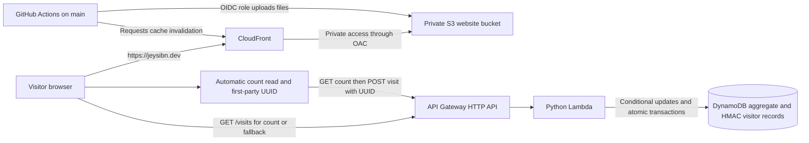

# Architecture

## Live system: V2

The live portfolio runs in AWS account `665514296439`, region `ap-southeast-2`. CloudFront serves [jeysibn.dev](https://jeysibn.dev) from a private S3 bucket. The visitor API is an API Gateway HTTP API backed by Python Lambda and DynamoDB.



### Visitor registration and counting

1. On page load, the portfolio requests `GET /visits` to display the aggregate. If registration is supported and localStorage is available, it registers with `POST /visits`. A random browser UUID v4 is stored in first-party localStorage and sent only to the API; the server stores only its keyed HMAC digest.
2. A saved `jeysibn.visitor-counting-consent.v1 = declined` preference from the prior UI is honored: the aggregate still loads, but no registration or UUID creation occurs. New visitors have no opt-in control; this change is not a legal conclusion that consent is unnecessary. Storage failure degrades to display-only counting.
3. `POST /visits` sends `{ "visitorId": "<UUID v4>" }`. Lambda validates the shape, HMAC-SHA256 hashes it with the existing Terraform-managed secret, and uses `visitor#<digest>` as the DynamoDB key. Raw IDs are not stored or logged.
4. A new browser or one whose `active_until` is at or before the current UTC time increments the existing `visitors.count` in the same DynamoDB transaction that writes visitor state. A visit inside the active window updates its history and extends the deadline without changing the aggregate. Conditional writes resolve concurrent requests.
5. React StrictMode replays and concurrent remounts share an in-flight registration promise; settled promises are cleared so a later mount/page load extends activity. If GET succeeds but POST fails, the fetched aggregate remains visible. If GET fails, a Retry control performs GET only, avoiding accidental registration retries. Responses use `Cache-Control: no-store`.

### DynamoDB records and retention

The existing table key is `id`. The `id = visitors` item and its historical count are preserved. Anonymous browser records use `id = visitor#<server-derived HMAC digest>` and store UTC Unix-second timestamps and counters:

| Attribute | Meaning |
| --- | --- |
| `first_seen_at` | First recorded visit in the current retained history period; reset when `expires_at <= now`, even if the item remains physically present. |
| `last_seen_at` | Most recent accepted registration. |
| `active_until` | Application eligibility deadline, set to the latest visit plus 86,400 seconds. This controls counting; DynamoDB TTL is not consulted. |
| `page_loads` | Total accepted registrations observed for this browser record. |
| `counted_visits` | Eligible visits that incremented the aggregate for this browser record. |
| `is_returning` | True after a repeat registration has been observed. |
| `expires_at` | Separate logical history-retention deadline and DynamoDB TTL deadline, refreshed to 90 days after the latest registration. |

UTC epoch seconds are convenient for comparisons; convert them to `Asia/Manila` when reviewing operational records. `active_until` determines whether a registration counts again after 24 hours. Independently, once `expires_at <= now`, the handler treats a still-present record as a new retained history period: it replaces `first_seen_at` and resets activity counters, returning status, and both deadlines while incrementing the aggregate atomically. A conditional write verifies the observed expiration so concurrent resets count once; if TTL deletes the item between read and transaction, the handler rereads and creates a first-visit record. DynamoDB physical TTL deletion remains asynchronous and can lag the logical deadline. There is no secondary index and no scan on public requests. Private operational review can scan the table; that is an off-path, potentially paginated read, not an analytics endpoint. Restrict AWS console and CLI permissions because records contain visit history and HMAC identifiers.

An authorized operator can inspect recent records without exposing them publicly:

```bash
aws dynamodb scan \
  --table-name cloud-resume-v2-visitor-counter \
  --filter-expression 'begins_with(#id, :prefix)' \
  --projection-expression '#id, first_seen_at, last_seen_at, active_until, page_loads, counted_visits, is_returning, expires_at' \
  --expression-attribute-names '{"#id":"id"}' \
  --expression-attribute-values '{":prefix":{"S":"visitor#"}}'
```

The command is read-only, may return several pages, and should be used sparingly. The HMAC key is in restricted Terraform state and Lambda configuration. The Lambda role is scoped to table `GetItem`, `PutItem`, and `UpdateItem`; API Gateway retains its existing 2 requests/second rate and burst 5 throttles.

### Privacy and interpretation

This is recognition of a browser-held random token, not identification of a person. Automatic counting means the persistent identifier is created and used without an in-page consent control; this is not a legal determination that consent is unnecessary. Browser storage can be cleared, copied, blocked, or spoofed; a person can use multiple browsers, and several people can share a browser. A caller can invent IDs, and the public unauthenticated API is not bot protection. The counter is an estimate of recorded eligible visits, not unique people. The aggregate retains the previous IP-based count, so totals span two different methodologies and must not be described as historical unique-browser totals.

Automatic registration creates and uses a persistent first-party localStorage UUID without an in-page control. The legacy decline value remains honored, giving prior visitors display-only behavior without reintroducing hero consent buttons. New visitors can avoid persistent recognition by blocking or clearing site storage; blocked storage still permits the aggregate count. This implementation note does not establish that consent is unnecessary. The site owner should determine the lawful basis, notice, and user choices required for the locations and context involved. See the [NPC Data Privacy Act](https://privacy.gov.ph/data-privacy-act/), [NPC advisories and Circular 2023-04](https://privacy.gov.ph/pips-and-pics/advisories-circulars/), and [EDPB technical-scope guidelines](https://www.edpb.europa.eu/documents/guideline/guidelines-22023-on-technical-scope-art-53-of-eprivacy-directive_en).

### Migration and deployment

No data migration is required. The aggregate `visitors` item is not managed by Terraform and is not reset. Existing `ip#...` items are not mapped to browsers; TTL removes them eventually. The new handler writes `visitor#...` records. Enhanced `GET /visits` includes `registrationSupported: true`. The frontend checks this flag before sending an automatic UUID registration. A legacy backend lacks this flag, so the frontend displays the aggregate with GET only and sends no POST. A preexisting declined local preference also keeps the page display-only. The enhanced backend accepts a legacy bodyless POST as a read-only compatibility request and returns `{ "counted": false, "count": n }`; it creates no record and performs no IP-derived tracking. Keep this low-risk compatibility path deliberately until a planned breaking API change after legacy clients are no longer supported. These mixed-version combinations preserve display but cause a temporary registration gap.

Deploy the compatible backend first, verify it, then publish the frontend through the manually approved V2 Portfolio CI/CD workflow. This PR changes no infrastructure and requires no Terraform apply. Keep the enhanced backend for rollback and revert the frontend first. The legacy backend capability response prevents registration when the new frontend sees the old service. Avoid backend-only rollback while cached clients may remain open. Never run an unreviewed Terraform plan or apply; the [backend runbook](backend-cicd.md) describes the gated release and rollback.

## Frontend deployment flow

Pull requests to `main` run frontend and backend checks. A maintainer separately reviews and applies any approved Terraform plan, then manually starts **V2 Portfolio CI/CD** on `main` to publish the frontend. The workflow uses GitHub OIDC, uploads assets before `index.html`, and requests a CloudFront invalidation. It does not apply Terraform.

## Incremental visitor-counter cost estimate

Estimate for `ap-southeast-2` (Sydney), USD, using AWS public on-demand prices checked 2026-11-07. Each page load adds two HTTP API requests and two Lambda invocations (GET and POST). Assume 256 MB Lambda memory and 100 ms average duration per invocation. The GET path uses one strongly consistent DynamoDB read. POST uses one strongly consistent visitor read plus one strongly consistent aggregate read. Assume records fit under 4 KB; repeat visits use one ordinary write, while an eligible visit uses a two-item transaction (four write request units if each item fits in 1 KB). For a conservative upper bound, treat every page load as eligible; repeated visits cost less in writes. Use $1.00 per million HTTP API requests, $0.20 per million Lambda requests and $0.0000166667 per GB-second; DynamoDB estimate uses $0.125 per million read request units and $0.625 per million write request units from AWS's published pricing example. Actual Sydney line items, data transfer, logs, storage, and applicable free tier / credits can change the invoice. Free-tier pricing is excluded.

| Page loads/month | HTTP API requests | Lambda invocations | DynamoDB reads (RRUs) | DynamoDB writes (WRUs, eligible upper bound) | Estimated added monthly cost |
| ---: | ---: | ---: | ---: | ---: | ---: |
| 100 | 200 | 200 | 300 | 400 | ~$0.00032 |
| 1,000 | 2,000 | 2,000 | 3,000 | 4,000 | ~$0.0032 |
| 10,000 | 20,000 | 20,000 | 30,000 | 40,000 | ~$0.032 |

At these volumes, extending `expires_at` on every return visit adds one standard write request unit per visit. It is needed to retain the HMAC record for the stated 90-day inactivity retention; `active_until` independently extends by 86,400 seconds on each recognized active visit. DynamoDB TTL is asynchronous cleanup, not the eligibility check. The estimates exclude data transfer, CloudWatch logs, storage and account-level charges. They assume $1 per million HTTP API calls and DynamoDB unit rates in AWS's published pricing example; use the AWS Pricing Calculator or actual Sydney bill line items for a region-specific quote. See AWS [API Gateway pricing](https://aws.amazon.com/api-gateway/pricing/), [Lambda pricing](https://aws.amazon.com/lambda/pricing/), [DynamoDB pricing](https://aws.amazon.com/dynamodb/pricing/), and the [DynamoDB read/write unit rules](https://docs.aws.amazon.com/amazondynamodb/latest/developerguide/read-write-operations.html).

## V1 history

V1 was manually provisioned in an older AWS project, which has since closed. Its source remains historical and its AWS state must not be reused.
