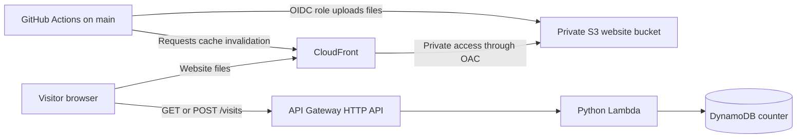

# Architecture

## Live system: Version 2

The live portfolio runs in AWS account `665514296439`, region `ap-southeast-2`. The website is [https://d1ezqc8d2heo4m.cloudfront.net/](https://d1ezqc8d2heo4m.cloudfront.net/).

### What each service does

| Service | Purpose in this project |
| --- | --- |
| Amazon S3 | Stores the built React website. The bucket is private. |
| CloudFront | Delivers website files over HTTPS and reads from S3 through Origin Access Control (OAC). |
| API Gateway | Exposes the visitor-counter API at `https://kfpwu0cd7k.execute-api.ap-southeast-2.amazonaws.com`. |
| AWS Lambda | Runs the Python handler when API Gateway receives a counter request. |
| DynamoDB | Stores the item with `id = visitors` and its numeric `count`. |
| Terraform | Creates and configures the V2 AWS resources. State uses a separate S3 bucket and V2 key. |
| GitHub Actions | Tests frontend changes and deploys the frontend when manually started on `main`. |

### Counter request flow

1. The browser downloads the React site from CloudFront. CloudFront reads the files from the private S3 bucket using OAC.
2. The page sends `GET /visits` to read the counter. Loading or refreshing the page does not increment it.
3. When a visitor clicks **Record My Visit**, the page sends `POST /visits`. Lambda atomically adds one to the existing DynamoDB item.

The counter measures recorded button clicks, not unique visitors. The API is public. CORS controls which browser origins may read responses; it does not authenticate callers or block non-browser requests. The API routes currently use no authorization, so do not treat CORS or the button's click lock as abuse protection.

Terraform creates the DynamoDB table but not its starting item. The item is initialized separately. If the item is missing, GET returns 404 and POST fails its condition rather than silently creating a new counter.

### Frontend deployment flow

Pull requests to `main` run TypeScript checks, lint, unit tests, and a production build. The deploy job is skipped. After changes are merged, a maintainer manually starts **V2 Portfolio CI/CD** on `main`. GitHub assumes the restricted AWS role through OIDC, uploads assets before `index.html`, and requests a CloudFront invalidation. The workflow does not run Terraform or delete S3 objects.

## Version 1 history

V1 was manually provisioned in an older AWS project, which has since been closed. Its service choices informed the V2 design, but its AWS resources are not live and its Terraform state must not be reused. Azure details in the portfolio refer to a separate historical project.
