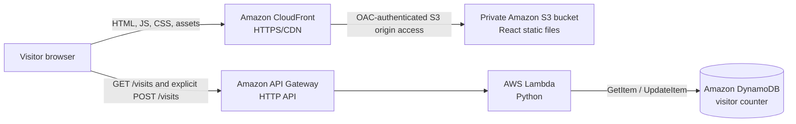

# Version 1 — AWS architecture

**Status:** Manually provisioned and deployed; production smoke tests reported passed on 2026-10-30. This page documents the observed architecture, not an infrastructure-as-code implementation.

## System overview

CloudFront serves the React/TypeScript/Vite bundle stored in the private S3 bucket. The frontend makes separate cross-origin HTTPS calls to API Gateway; API requests are **not** proxied through the CloudFront distribution. Lambda reads or updates the DynamoDB counter.

## Known resources

| Component | Observed/documented value | Verification boundary |
| --- | --- | --- |
| AWS region | `ap-southeast-2` (Sydney) | User-selected deployment region |
| Frontend | `https://d31yy7ezo2w9ph.cloudfront.net/` | User reports working production React site |
| S3 bucket | `cloud-resume-lab-jeysibn` | User reports private bucket; Block Public Access and OAC confirmed in Console |
| CloudFront | Existing distribution, with S3 origin, OAC, default root object `index.html` | User's 5.5.3 Console verification |
| API Gateway | HTTP API `cloud-resume-visitor-api` | Routes and working GET/POST reported by user |
| API endpoint | `https://10lm4byr49.execute-api.ap-southeast-2.amazonaws.com` | Tested from local React; CloudFront-origin GET passed |
| Routes | `GET /visits`, `POST /visits` | Both routes exist |
| Lambda | `cloud-resume-visitor-function` (Python 3.14) | Runtime owner-confirmed; recovered backend source and owner-reported exact deployed ZIP CodeSha256 match for $LATEST |
| DynamoDB | `cloud-resume-visitor-counter`; item `id = visitors`, attribute `count` | User confirmed count changed 7 → 8 |
| Monitoring | CloudWatch logs for Lambda | Log details and current retention not independently verified |
| Cost alert | User-configured alert threshold of USD 5/month | Alert is **not** a hard cost cap |

**Not yet recorded from an AWS Console inspection:** CloudFront distribution ID/OAC ID and cache policies; S3 versioning and lifecycle settings; API Gateway authorization and exact throttling; Lambda memory/timeout and IAM policy JSON; DynamoDB billing mode; CloudWatch log retention/current alarms; billing-alert notification confirmation. Do not infer these values from resource names.

## Visitor-count contract

- **GET `/visits`** reads the current integer count without incrementing it; expected JSON: `{"count": 8}` (8 was the observed test value, not a fixed count).
- **POST `/visits`** records one visit, without a required request body. The frontend invokes POST only after a deliberate click on **Record My Visit**.
- A successful POST is followed by GET to refresh the visible count. The client does not automatically retry POST, since the increment might have succeeded even if the response was lost.
- The count represents **recorded actions**, not unique visitors or verified humans. A frontend button lock only prevents repeated submission in the current page instance; it is not a security boundary.
- In the controlled local integration test, one successful POST changed DynamoDB count from **7 to 8**. On the deployed CloudFront site, GET worked; no deliberate production POST was sent as part of the release smoke tests.
- CORS permitted the tested local React origin and CloudFront origin for GET. The user configured GET/POST in API Gateway; browser-origin production POST has not separately been exercised.

## Security model and trade-offs

- S3 remains private with Block Public Access enabled. CloudFront uses **Origin Access Control (OAC)** to read objects; do not make the bucket public for static hosting.
- CloudFront provides the public HTTPS entry point for static assets.
- API Gateway is accessed directly by the browser, so its URL is intentionally public. `VITE_API_BASE_URL` is a **public build-time setting**, not a place for credentials.
- The counter POST endpoint is intended as a public demo action. CORS does **not** authenticate callers or prevent non-browser requests. API authorization and enforcement of throttling must be verified from the Console before asserting protection against abuse.
- IAM was designed with least-privilege DynamoDB read/update actions; verify its current attached policies in AWS before claiming an audited least-privilege implementation.
- Historical Azure details in the portfolio's project case study describe a **separate earlier system**. No AWS Terraform provisioning or GitHub Actions deployment is implemented in Version 1.

## Architecture decisions

1. **Static frontend via S3 + CloudFront:** no always-on application server for React; private S3 origin reduces direct public exposure.
2. **HTTP API + Python Lambda:** small request-driven counter backend without managing a server.
3. **DynamoDB:** persistent counter stored outside browser sessions; the recovered implementation uses a conditional atomic UpdateItem expression to avoid lost increments; see backend/lambda/lambda_function.py.
4. **Read-only GET + intentional POST:** loading or refreshing the portfolio does not automatically increment the counter.
5. **Manual console-based deployment:** deliberately learn each AWS resource before moving to Terraform/CI/CD in Version 2.

## Official references

- [CloudFront access to private S3 origins with OAC](https://docs.aws.amazon.com/AmazonCloudFront/latest/DeveloperGuide/private-content-restricting-access-to-s3.html)
- [CloudFront invalidations](https://docs.aws.amazon.com/AmazonCloudFront/latest/DeveloperGuide/Invalidation_Requests.html)
- [HTTP API Gateway CORS](https://docs.aws.amazon.com/apigateway/latest/developerguide/http-api-cors.html)

See [deployment runbook](deployment-runbook.md) and [validation record](validation.md).

## Recovered Lambda source boundary

The original [`lambda_function.lambda_handler`](../backend/lambda/lambda_function.py)
was copied byte-for-byte from the owner-supplied deployment ZIP. Python 3.14 is
owner-confirmed. The [provenance record](../backend/source-provenance.json) records
archive/source hashes. On 2026-10-30 the owner reported that API Gateway targets the\nunqualified Lambda (`$LATEST`) and that AWS `CodeSha256` exactly matched the ZIP's\nexpected fingerprint; this is strong at-the-time package-equivalence evidence,\nthough the AWS data was not independently fetched here.

GET calls GetItem with ConsistentRead=True on id=visitors. POST calls UpdateItem
with `SET #counter = #counter + :inc`, `:inc=1`, an existing-item condition and
UPDATED_NEW return values. Successful POST returns both a message and count; the
frontend remains compatible by refreshing via GET. The handler ignores the body
and path: API Gateway owns routing and CORS. It returns JSON 404 for a missing
GET item and 405 for unsupported methods, but lets SDK/data exceptions propagate.
It does not add headers, initialize missing counters or define a JSON 500 body.

The backend int() conversion does not enforce the frontend's nonnegative safe
integer range; correct numeric counter data is required. No runtime behavior was
changed. Tests mock boto3 before import and never contact AWS. See the
[backend configuration, contract and deployment guide](../backend/README.md).
