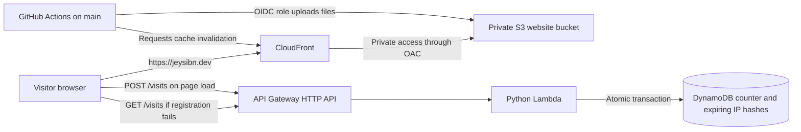

# Architecture

## Live system: Version 2

The live portfolio runs in AWS account `665514296439`, region `ap-southeast-2`. The public portfolio is [https://jeysibn.dev](https://jeysibn.dev). CloudFront serves it using the custom domain; the underlying distribution endpoint is [d1ezqc8d2heo4m.cloudfront.net](https://d1ezqc8d2heo4m.cloudfront.net/).

### What each service does

| Service | Purpose in this project |
| --- | --- |
| Amazon S3 | Stores the built React website. The bucket is private. |
| CloudFront | Delivers website files over HTTPS and reads from S3 through Origin Access Control (OAC). |
| API Gateway | Exposes the visitor-counter API at `https://kfpwu0cd7k.execute-api.ap-southeast-2.amazonaws.com`. |
| AWS Lambda | Runs the Python handler when API Gateway receives a counter request. |
| DynamoDB | Stores the `visitors` counter and temporary `ip#<HMAC>` records with `expires_at`. |
| Terraform | Creates and configures the V2 AWS resources. State uses a separate S3 bucket and V2 key. |
| GitHub Actions | Tests frontend changes and deploys the frontend when manually started on `main`. |

### Counter request flow

1. The browser downloads the React site from CloudFront. CloudFront reads the files from the private S3 bucket using OAC.
2. When the visitor-counter component mounts, React automatically sends `POST /visits`. Lambda validates the API Gateway source IP, derives an HMAC-SHA256 digest (grouping IPv6 by `/64`), then uses one DynamoDB transaction to record the digest and increment the existing counter only if that identifier has not been registered within the configured 24-hour window.
3. A repeat request from the same address during the configured 24-hour window returns the current count without incrementing it. If POST fails, the page reads the count with GET; Retry only repeats that read.

The counter approximates visitors by public IP-derived identifier per configured 24-hour window; it is not an exact count of unique people. Shared NAT or carrier-grade NAT can combine people into one count; VPN and mobile IP rotation can count one person more than once. Bots that run JavaScript can be counted. The total preserves historical counts from the previous implementation. The API is public and unauthenticated, so it is not abuse protection. CORS controls which browser origins may read responses; it does not authenticate callers or block non-browser requests.

Raw IPs are not stored by the handler. HMAC hashes reduce exposure but may still be personal data under some regimes. DynamoDB TTL removes the hash records after expiry, usually within 24–48 hours. The expiry condition in the transaction enforces the 24-hour window even before asynchronous TTL deletion occurs.

Terraform creates the DynamoDB table but not its starting item. The item is initialized separately. If the item is missing, GET returns 404 and POST fails its condition rather than silently creating a new counter.

### Frontend deployment flow

Pull requests to `main` run TypeScript checks, lint, unit tests, and a production build. The deploy job is skipped. After changes are merged, a maintainer manually starts **V2 Portfolio CI/CD** on `main`. GitHub assumes the restricted AWS role through OIDC, uploads assets before `index.html`, and requests a CloudFront invalidation. The workflow does not run Terraform or delete S3 objects.

## Version 1 history

V1 was manually provisioned in an older AWS project, which has since been closed. Its service choices informed the V2 design, but its AWS resources are not live and its Terraform state must not be reused. The older GitHub Pages/Azure portfolio is a separate historical project, not the current live AWS case study.
