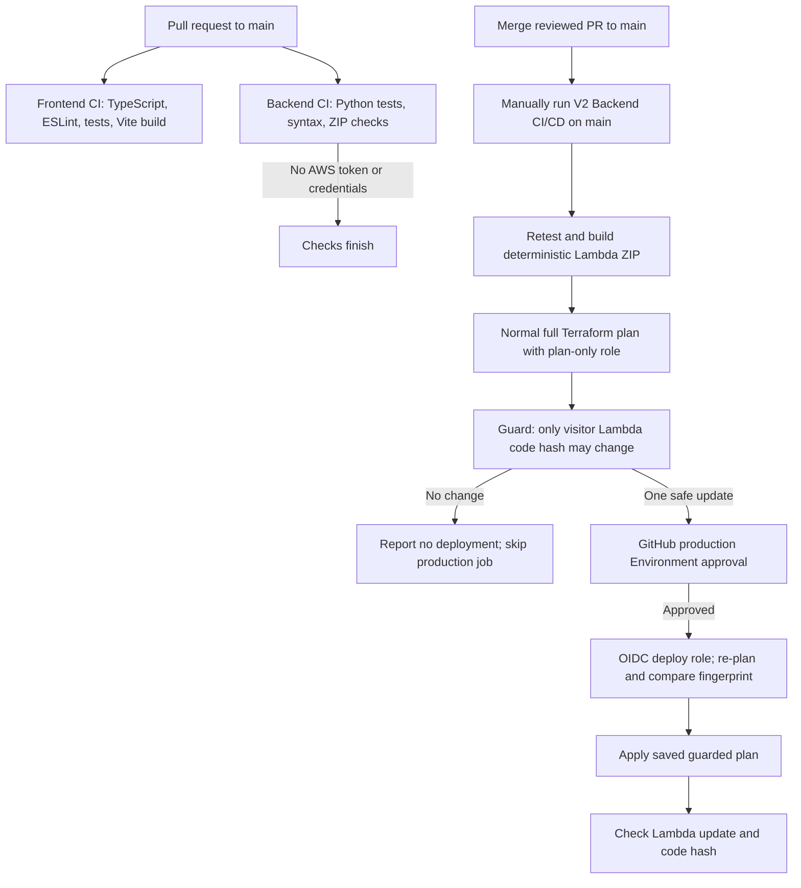

# Backend CI/CD for Version 2

This guide explains how a backend change is checked and how an approved change reaches the V2 Lambda. **The production approval rule is configured in GitHub, outside this repository. A workflow line that says `environment: production` does not create an approval rule by itself. Do not run the deployment until the setup checklist below is complete and verified.**

## The flow



**CI** means continuous integration: automatically checking proposed code. **CD** means controlled delivery: taking a reviewed change and releasing it. Pull requests run checks only. They cannot assume either AWS role. Backend deployment is a separate manually started workflow and only accepts `main`.

## How backend CI works

The `Backend CI (Python 3.14)` job is in `.github/workflows/deploy-v2.yml` beside the existing frontend job. On pull requests to `main`, it:

1. Installs Python 3.14.
2. Runs `python3 -m unittest discover -s backend/tests -v`. These tests mock AWS SDK calls, so they do not contact AWS.
3. Compiles the Lambda, packaging script, and Terraform guard to catch Python syntax errors.
4. Runs `backend/lambda-v2/package.py` and checks ZIP integrity and the `lambda_handler` entry point.

The ZIP contains one file, `lambda_function.py`. The packaging script fixes the ZIP timestamp and metadata, so the same source produces the same ZIP bytes. That makes its SHA-256 code hash useful for checking that the reviewed package is the one Terraform plans and Lambda receives.

The backend CI job has only `contents: read`; it has no `id-token: write`, AWS credential action, or deployment step. The frontend workflow's existing checks and S3/CloudFront deployment remain in their existing jobs.

## How the manual deployment works

The `V2 Backend CI/CD` workflow is started from **Actions → V2 Backend CI/CD → Run workflow**, selecting `main`. It checks out the exact commit selected for that run, repeats the backend tests, rebuilds the ZIP, and uploads it briefly as a workflow artifact so the plan job uses those exact bytes.

Terraform is the source of truth for the Lambda configuration. The Lambda resource sets `filename` to `backend/lambda-v2/function.zip` and `source_code_hash` to the ZIP's base64 SHA-256. Terraform therefore detects changed code as a Lambda update while keeping runtime, handler, role, memory, and other configuration managed in `infra/terraform/`.

The plan job uses a normal full `terraform plan`; it does not disable refresh, locking, or use `-target`. The guard reads Terraform's JSON plan and permits only one in-place update to `aws_lambda_function.visitor`. It checks the exact function name, package path, and source hash, and rejects replacements, deletions, other resource changes, drift, output changes, imports, and unknown values it must verify.

The plan summary contains only a safe fingerprint, not Terraform state or the full plan JSON. After approval, the workflow creates a new full plan and compares its fingerprint with the reviewed one. If anything material differs, it stops before apply. Terraform's saved plan is applied only after this check. The workflow then waits for Lambda and compares AWS's code hash to the ZIP hash.

### No-op deployment

If the package has not changed and Terraform reports no infrastructure difference, the guard returns `NOOP`. The workflow reports **No backend deployment required**, finishes successfully, and skips the production approval and deploy job. If Terraform detects any drift, output change, unrelated resource change, or unverifiable value, the guard fails instead of labeling it a no-op.

## Why production approval matters

The deployment job declares `environment: production`. GitHub evaluates that Environment's protection rules before starting the job, including before its AWS credential step. But if the Environment is missing, GitHub can create it without reviewers. That would not be an approval gate.

**Before opening the pull request or running a deployment, a repository administrator must configure the Environment outside this code:**

1. Open **Repository Settings → Environments → New environment** (or select the existing `production`).
2. Require at least one trusted reviewer. Use a reviewer other than the person starting the deployment; enable prevention of self-review and administrator bypass where the repository plan offers those controls.
3. Restrict deployment branches to `main` (the selected branch only).
4. Save, then re-open the Environment settings and verify the required reviewers and branch rule are active.

If the repository plan does not support required reviewers, do not treat the Environment as an approval gate. Stop and choose an approved alternative control before enabling production deployment.

## OIDC and AWS roles

OpenID Connect (**OIDC**) lets GitHub request short-lived AWS credentials for one job. The workflow does not store a permanent AWS access key in GitHub. Only jobs that declare `id-token: write` can request an OIDC token.

There are two separate backend roles:

| Role | Job | Trust subject |
| --- | --- | --- |
| `cloud-resume-v2-backend-plan` | Full plan before approval | `repo:Jeysibn@184398348/cloud-resume-challenge@1438062067:ref:refs/heads/main` |
| `cloud-resume-v2-backend-deploy` | Production job after approval | `repo:Jeysibn@184398348/cloud-resume-challenge@1438062067:environment:production` |

Both policies additionally check the repository, `refs/heads/main`, audience `sts.amazonaws.com`, and workflow name `V2 Backend CI/CD`. A job using an Environment has an `environment:production` subject, not a branch subject; its separate `ref` claim is used to keep it on `main`. The subject includes immutable owner and repository IDs for this repository.

The plan role has read permissions for resources Terraform refreshes and narrowly scoped state/lock access. It has no Lambda code write action. The deploy role has the same Terraform permissions and only `lambda:UpdateFunctionCode` on `cloud-resume-v2-visitor-function`. The workflow also checks AWS account `665514296439` and region `ap-southeast-2` before planning or applying.

### Terraform state and S3 permissions

The remote state uses the exact V2 key `cloud-resume-challenge/v2/terraform.tfstate` in the configured S3 bucket, with encryption and S3 lock files enabled. The policy limits object access to that state key and its `.tflock` key. Locking must remain enabled; do not use `-lock=false` to work around access errors.

HashiCorp's S3 backend documentation lists `s3:GetObject` and `s3:PutObject` on the state object, `s3:ListBucket` on the relevant prefix, and `GetObject`/`PutObject`/`DeleteObject` on the lock object for the backend. A normal plan can refresh state and may need to persist refreshed state, so the policy retains state `PutObject` instead of assuming a plan never writes. This permission is confined to the V2 state key, but it is a meaningful capability: a trusted operator must still protect the role and bucket. The exact behavior under this account's bucket policy, encryption key, and any permission boundary has not been verified against live AWS. Validate those controls during an approved bootstrap/first plan; do not remove state write permission based only on local tests.

The state bucket is outside this Terraform stack. An AWS administrator must verify versioning, encryption, public-access blocking, and a restrictive bucket policy. Terraform formatting/validation does not test these live bucket controls.

## One-time AWS bootstrap checklist

The workflow roles and their policies are declared in `infra/terraform/github-actions.tf`; that file does not create them until a trusted operator applies Terraform. The existing frontend role is preserved. Before first deployment:

1. Complete and verify the GitHub `production` Environment controls above.
2. Confirm AWS has the GitHub OIDC provider at `token.actions.githubusercontent.com`, audience `sts.amazonaws.com`, and the configured S3 state bucket/key. Verify state bucket versioning, encryption, public blocking, and its bucket policy.
3. Using an approved AWS operator identity, initialize Terraform and inspect a full plan that creates the two backend roles and policy. Do not use `-target`; stop if the plan includes unrelated live changes.
4. Have the infrastructure owner approve and apply that reviewed bootstrap plan using the organization's normal process. This is a live AWS change and must be separately authorized; this repository workflow does not perform bootstrap.
5. Verify the roles' trust subjects and inline/attached permissions in AWS. Confirm both roles are limited to this repository/main/workflow and that only the deploy role has `lambda:UpdateFunctionCode`.
6. Verify the GitHub Environment protection rule independently. IAM trust alone cannot require a human reviewer.

Useful read-only/local commands (the `terraform plan` command below contacts AWS and needs approved credentials):

```sh
cd infra/terraform
terraform fmt -check -recursive
terraform init -backend=false
terraform validate
# For an approved operator session only:
terraform init
terraform plan -out=backend-cicd-iam.tfplan
terraform show -no-color backend-cicd-iam.tfplan
```

## Deploy a backend feature

1. Create a feature branch and implement the Lambda change with unit tests.
2. Open a pull request targeting `main`. Wait for both `Frontend CI` and `Backend CI (Python 3.14)` to pass. Neither job can deploy to AWS.
3. Merge only after review and required repository checks.
4. After merge, manually start `V2 Backend CI/CD` and select `main`. The run checks out the selected commit SHA; it does not deploy pull request commits.
5. Read the plan job result. A no-op means there is nothing to deploy. For an update, confirm the commit and safe summary are expected.
6. Approve the pending `production` Environment deployment only after checking the commit and change. GitHub must show the configured reviewer gate; if the job starts immediately, cancel it and fix the Environment configuration.
7. The workflow re-plans and compares fingerprints after approval. A mismatch stops without applying. A matching plan is applied, then Lambda's update state and code hash are checked.

## Check status and troubleshoot

Open **Actions** and select the workflow run. The `validate`, `plan`, `report-noop`, and `deploy` jobs show the stage and result. A skipped deploy job is expected for a safe no-op. The workflow writes a deployment success/failure summary. It never prints state or uploads plan JSON.

| Message or symptom | Meaning and next step |
| --- | --- |
| Deployment stopped because selected ref is not `main` | Start a new manual run with `main` selected. |
| Deployment job starts without waiting for review | Cancel it. The external Environment protection rule is missing or ineffective; configure and verify it before another run. |
| OIDC access denied | Check the OIDC provider, immutable subject IDs, `main` ref, workflow name, role ARN, and (for deploy) Environment subject and required reviewer setup. |
| Terraform plan cannot read state or lock | Check the exact V2 bucket/key, S3 permissions, bucket policy, encryption key policy, and lock object permissions. Never manually remove a lock while a run may still be active. |
| Terraform plan gets an AWS read access denied error | Identify the precise read API/resource Terraform needs for refresh. Add only that read permission after review; do not grant broad write access. |
| Guard rejects the plan | Stop and inspect Terraform safely with an authorized operator. Resolve drift or unrelated infrastructure changes separately; do not weaken the guard to force a release. |
| Fingerprints differ after approval | Terraform's view changed between review and apply. No apply occurred. Review a fresh run and approve it only if the new summary is expected. |
| Plan says no backend deployment required | The package hash matches. No AWS resource update or approval job is needed. |
| Lambda wait/hash check fails | Inspect Lambda update status and CloudWatch logs. The workflow reports failure and does not attempt an automatic rollback. |
| Tests or ZIP validation fail | Reproduce with the commands below and fix the source or packaging before merging. |

Useful local commands:

```sh
python3 -m unittest discover -s backend/tests -v
python3 -m py_compile backend/lambda-v2/lambda_function.py backend/lambda-v2/package.py backend/scripts/guard_terraform_plan.py
python3 backend/lambda-v2/package.py
python3 - <<'PY'
from zipfile import ZipFile
with ZipFile("backend/lambda-v2/function.zip") as package:
    assert package.testzip() is None
    assert package.namelist() == ["lambda_function.py"]
    assert b"def lambda_handler(" in package.read("lambda_function.py")
print("ZIP is valid and contains the Lambda handler")
PY
```

## Frontend and backend deployment are different

Frontend CI/CD stays in `deploy-v2.yml`. Pull requests type-check, lint, test, and build React/Vite. A manual frontend run on `main` uses the existing frontend role to upload static files to private S3 and invalidate CloudFront.

Backend CI runs Python tests and validates a Lambda ZIP on pull requests. Backend CD is a separate manual workflow. It uses Terraform and separate plan/deploy roles to update only the Lambda code after the production approval gate. Both use GitHub OIDC short-lived credentials, but only the frontend deploy job and the backend plan/deploy jobs receive AWS access for their specific purposes.
