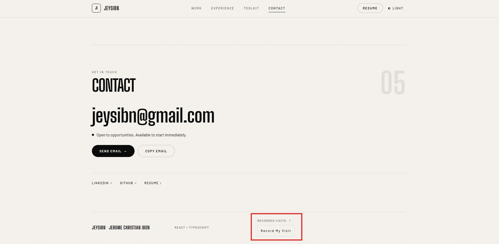
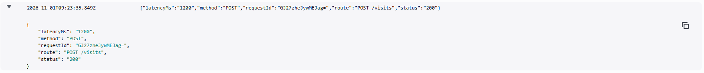
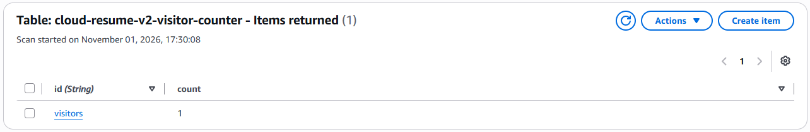

# Validation and current status

This page distinguishes local checks from live AWS checks. The unique-IP counter change is validated locally; no AWS resources or live API were accessed during its implementation.

## Local checks for the current source

The following checks passed locally on November 4, 2026:

```bash
python3 -m unittest discover -s backend/tests -v
python3 -m py_compile backend/lambda-v2/lambda_function.py backend/lambda-v2/package.py
python3 backend/lambda-v2/package.py
cd frontend/app
npm run typecheck
npm run lint
npm test -- --run
npm run build
cd ../../infra/terraform
terraform fmt -check
terraform validate
```

| Check | Result |
| --- | --- |
| `python3 -m unittest discover -s backend/tests -v` | Passed: 27 tests, including V1 source tests; AWS calls are mocked |
| Python compilation and Lambda ZIP packaging | Passed; ZIP contains `lambda_function.py` at the root |
| Frontend typecheck and lint | Passed |
| `npm test -- --run` | Passed: 73 tests in 16 files |
| Frontend production build | Passed |
| `terraform fmt -check` and `terraform validate` | Passed |

Backend and frontend tests use mocks and do not modify AWS or the live counter. Terraform validation checks configuration; it does not deploy anything. The unique-IP implementation has not been smoke-tested against AWS yet.

## Previous live validation (historical behavior)

The following evidence predates the unique-IP change and validated the former **Record My Visit** button flow. It does not prove the current automatic registration, IP-derived deduplication, or TTL behavior. The current implementation retains the previous counter's aggregate total; no live POST was sent as part of the documentation update.

### Mission 9.1 — Previous Visitor Counter End-to-End Test

**Date:** November 1, 2026

**Environment:** AWS V2 (`ap-southeast-2`, Sydney)

**Result:** PASS for the button-click counter then deployed

The earlier test clicked **Record My Visit**, observed the count increase by one, confirmed the DynamoDB count, and refreshed the page. Those results describe the old behavior only. Current POST registration is automatic on component mount; repeated requests from the same IP-derived identifier do not increment the count again within the configured 24-hour window. Current AWS behavior has not been live-verified in this record.

Screenshots from the prior live test:







The old live checks reported the homepage and GET endpoint working and had no production POST during the initial deployment. The November 1 button test later sent a production POST. No current live API check has been performed for the unique-IP change.

### Custom domain and follow-up counter check

**Date:** November 1, 2026

**Environment:** AWS V2 (`ap-southeast-2`, Sydney)

**Result:** PASS for the prior button-click implementation

The portfolio was opened successfully at [https://jeysibn.dev](https://jeysibn.dev). A follow-up live test clicked **Record My Visit** and increased the count from 1 to 2. This is historical production evidence for the prior implementation, not validation of the unique-IP behavior.

The CloudFront distribution remains the delivery layer behind the custom domain.

### Custom domain and follow-up counter check

**Date:** November 1, 2026

**Environment:** AWS V2 (`ap-southeast-2`, Sydney)

**Result:** PASS

The portfolio was opened successfully at [https://jeysibn.dev](https://jeysibn.dev). In a follow-up historical test of the prior button-based implementation, clicking **Record My Visit** increased the counter from 1 to 2. This live production update is not an automated CI test and does not validate the current unique-IP behavior.

The CloudFront distribution remains the delivery layer behind the custom domain. The custom domain is the URL to share publicly.

## Dependency audit

The latest recorded `npm audit` on 2026-11-01 found 12 moderate issues in development tooling; `npm audit --omit=dev` found none in production dependencies. See the [dependency security check](../frontend/app/DEPENDENCY-SECURITY-REVIEW.md) for details and recheck commands. This audit is separate from the build and test results above.

## Version 1 history

V1 was manually deployed in an older AWS project that is now closed. Its 2026-10-30 tests and observations are historical; they are not proof of current V2 behavior. See [architecture](architecture.md) for the current system and V1 distinction.
