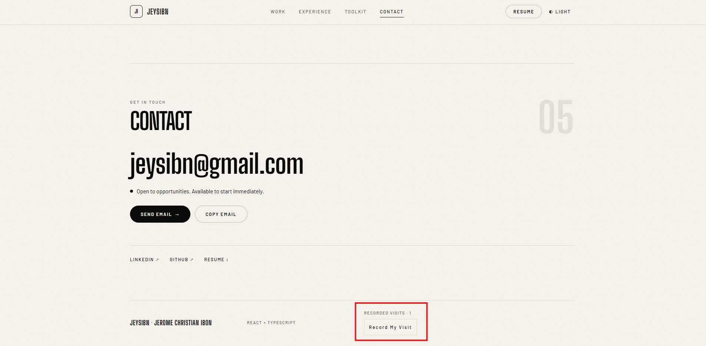
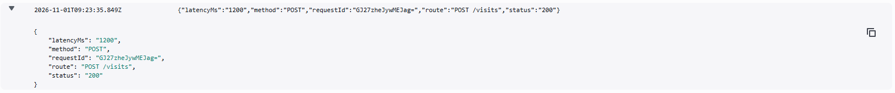
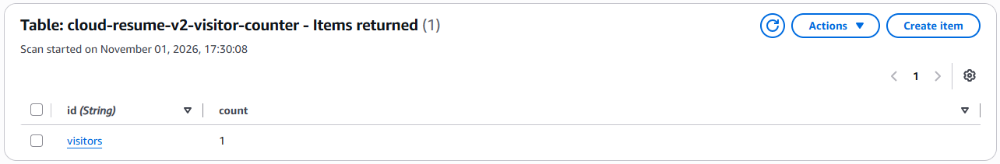

# Validation and current status

This page records checks for the live Version 2 project. It separates automated checks from live AWS checks so that mocked tests are not mistaken for production tests.

## Local checks

The following checks passed against the V2 source during the release preparation:

| Check | Result |
| --- | --- |
| `terraform fmt -check` and `terraform validate` | Passed |
| `python3 -m unittest discover -s backend/tests -v` | 17 tests passed; AWS calls are mocked |
| Frontend typecheck and lint | Passed |
| `npm test -- --run` | 58 tests passed in 15 files |
| Production build | Passed with the V2 API URL |
| Metadata check | Passed; canonical URL is the V2 CloudFront site |
| Performance budget | Passed: JavaScript bundle is below the configured budget |
| `git diff --check` | Passed |

The backend tests and frontend unit tests do not modify AWS or the live counter.

## GitHub Actions checks

- PR #4: `build-and-test` passed; `Deploy V2 to AWS` was skipped for the pull request.
- Manual OIDC deployment: [workflow run 41213992608](https://github.com/Jeysibn/cloud-resume-challenge/actions/runs/41213992608) passed both build and deployment jobs.

The deployment workflow runs checks and builds a website artifact. Only a manual run on `main` deploys it.

## Live checks

- The live homepage returned HTTP 200 after the first OIDC deployment.
- The published JavaScript contained the V2 API endpoint.
- `GET /visits` returned HTTP 200 with `{"count":0}` after the counter was initialized.
- CloudFront accepted the invalidation request from the OIDC deployment workflow.

During the initial deployment checks, no production POST request was sent. A later end-to-end test on November 1, 2026 verified the POST functionality. The counter tracks recorded actions, not unique visitors.

### Mission 9.1 — Visitor Counter End-to-End Test

**Date:** November 1, 2026

**Environment:** AWS V2 (`ap-southeast-2`, Sydney)

**Overall Result:** PASS

**Objective:** Verify that the visitor counter works correctly from the frontend through the AWS backend and database.

| Test | Expected Result | Actual Result | Status |
| --- | --- | --- | --- |
| Initial counter | Displays 0 | Displayed 0 | PASS |
| Record My Visit button | Increases count by 1 | Changed from 0 to 1 | PASS |
| DynamoDB verification | Stores the updated count | Count was 1 | PASS |
| CloudWatch verification | Logs the Lambda POST request | POST request recorded | PASS |
| Browser refresh | Retains the saved count | Still displayed 1 | PASS |

**Conclusion:**

The visitor counter passed end-to-end testing. Clicking the Record My Visit button updated the displayed count from 0 to 1. DynamoDB stored the updated value, and CloudWatch recorded the POST request.

After refreshing the website, the counter remained at 1, confirming that the frontend could retrieve the persisted count.

No infrastructure changes were required during this test.

Screenshots from the live test:

This evidence is from a live AWS check, not an automated test. `POST /visits` changes the real counter. The counter tracks recorded actions, not unique visitors.

## Dependency audit

The latest recorded `npm audit` on 2026-11-01 found 12 moderate issues in development tooling; `npm audit --omit=dev` found none in production dependencies. See the [dependency security check](../frontend/app/DEPENDENCY-SECURITY-REVIEW.md) for details and recheck commands. This audit is separate from the passing build and tests.

## Version 1 history

V1 was manually deployed in an older AWS project that is now closed. Its 2026-10-30 tests and observations are historical; they are not proof of current V2 behavior. See [architecture](architecture.md) for the current system and V1 distinction.
